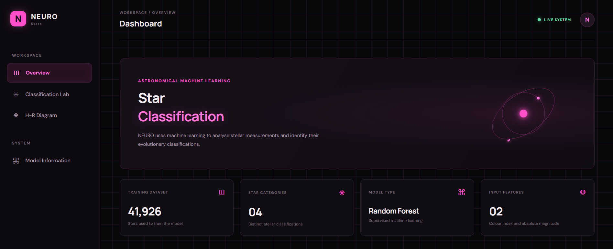
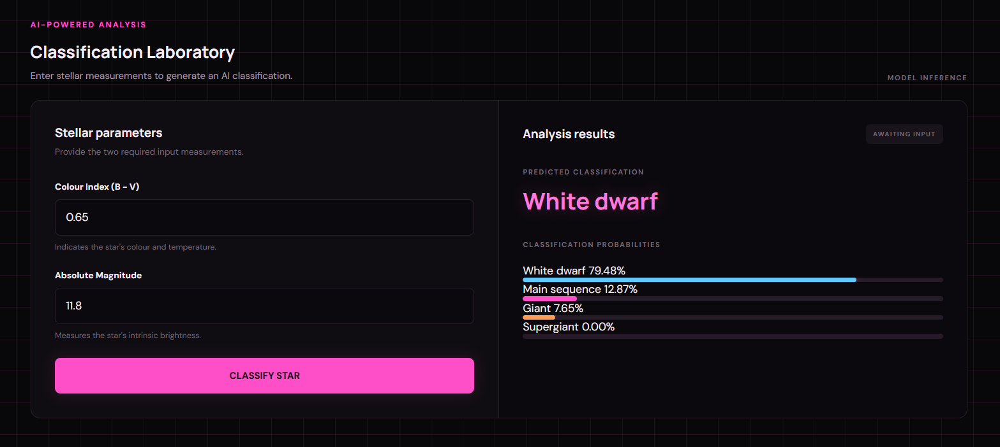
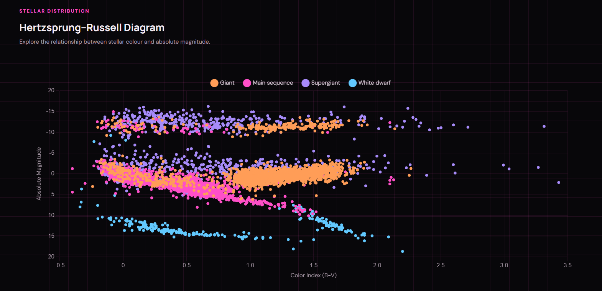

# NEURO---ML

## An AI-powered stellar classification system using Machine Learning.

NEURO is a machine learning project that explores stellar classification through astronomical data. It uses a Random Forest classifier to identify and categorize stars based on their Color Index (B−V) and Absolute Magnitude.

The project combines data preprocessing, exploratory data analysis, and machine learning.

### NEURO Web Application


## ⭐ Overview

Stars have different physical properties that help astronomers understand their characteristics and evolutionary stages.

NEURO uses two astronomical measurements to classify stars into four categories:

- **Main Sequence:** Stars that generate energy through hydrogen fusion in their cores.
- **Giant:** Large, luminous stars that have evolved beyond the main sequence.
- **Supergiant:** Extremely luminous and massive evolved stars.
- **White Dwarf:** Dense stellar remnants left behind by stars that have exhausted their nuclear fuel.

The classification is performed using a trained Random Forest machine learning model.

### Classification Laboratory



### H-R Diagram



## ⭐ Features

### Machine Learning Classification

- Predicts the stellar category using Color Index and Absolute Magnitude.
- Uses a Random Forest classification algorithm.
- Provides prediction probabilities for the predicted class.
- Trained and evaluated using astronomical star data.

### Data Analysis and Visualization

- Complete data exploration and preprocessing workflow.
- Visual analysis of astronomical measurements.
- Machine learning model development.
- Model evaluation and verification.

### Jupyter Notebook

- Complete data exploration and preprocessing workflow.
- Visual analysis of astronomical measurements.
- Machine learning model development.
- Model evaluation and verification.

## ⭐ How It Works

NEURO follows a machine learning pipeline consisting of several stages.

### 1. Data Collection

The project uses the HYG Star Database, containing astronomical information about stars.

### 2. Data Preprocessing

The original dataset is cleaned and prepared for classification.

- Removes records with missing or unusable classification information.
- Extracts stellar luminosity classifications from spectral types.
- Assigns stars to the four supported categories.
- Prepares Color Index and Absolute Magnitude as model features.

### 3. Exploratory Data Analysis

The cleaned dataset is analyzed through statistical summaries and visualizations to explore the distribution and relationships between stellar properties.

### 4. Model Training

A Random Forest classifier is trained using:

| Parameter | Value |
|---|---|
| Algorithm | Random Forest |
| Number of estimators | 200 |
| Maximum depth | 20 |
| Minimum samples per leaf | 2 |
| Maximum features | sqrt |
| Class weighting | balanced_subsample |
| Random state | 42 |

The dataset is divided into training and testing sets using an 80/20 split with stratification.

### 5. Model Evaluation

The model is evaluated using:

- Accuracy
- Precision
- Recall
- F1-score
- Confusion matrix

The evaluated model achieved approximately 91.43% accuracy on the test dataset.

### 6. Prediction

The trained model receives two numerical inputs:

- Color Index (B−V)
- Absolute Magnitude

It then predicts one of the four stellar categories and returns the associated class probabilities.

## ⭐ Technologies Used

| Technology | Purpose |
|---|---|
| Python | Main programming language |
| Flask | Web application backend |
| HTML | Webpage structure |
| CSS | Interface styling |
| JavaScript | Interactive functionality |
| Pandas | Dataset manipulation |
| NumPy | Numerical operations |
| Scikit-learn | Machine learning and evaluation |
| Joblib | Model serialization and loading |
| Matplotlib | Data visualization |
| Seaborn | Statistical visualizations |
| Jupyter Notebook | Data exploration and model development |

## ⭐ Installation and Setup

### 11. Install Git LFS

Git LFS is required because the trained machine learning model is stored using Git Large File Storage.

Install Git LFS from:

https://git-lfs.com/

Then run:

```bash
git lfs install
git lfs pull
```

### 2. Create a Virtual Environment

```bash
python -m venv .venv
```

Activate it on Windows:

```bash
.venv\Scripts\activate
```

### 3. Install Dependencies

```bash
pip install -r requirements.txt
```

### 4. Run the Application

```bash
python app.py
```

## Dataset

This project uses the HYG Star Database, an astronomical star catalogue containing information about stellar properties.

The dataset includes information such as:

- Stellar identifiers and names.
- Spectral classifications.
- Color Index.
- Absolute Magnitude.
- Other astronomical measurements.

The project uses spectral classification information to derive the target categories and uses Color Index and Absolute Magnitude as input features.

**Dataset source:** https://codeberg.org/astronexus/hyg

## Important Notes

- The model predicts stellar categories based on the two selected input features.
- It is an educational machine learning project, not a replacement for professional astronomical analysis.
- Prediction probabilities represent the model's confidence scores, not scientifically calibrated probabilities.
